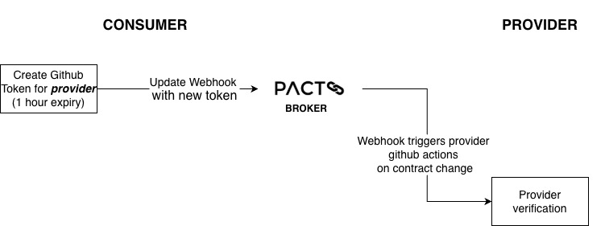

# Github Webhooks
Github tokens are now generated via github [app](https://github.com/organizations/ministryofjustice/settings/apps/hmpps-probation-test-trigger). Moving away from PAT tokens.

## Pre-requisites
- Repo has been installed the Github [app](https://github.com/organizations/ministryofjustice/settings/apps/hmpps-probation-test-trigger) via request in Slack #ask-developer-experience

## Consumer Workflow
Consumer refreshes the provider token before they publish a new consumer contract. Allowing the Pact Broker to trigger the provider github actions workflow via the webhook stored in this repo e.g. [hmpps-person-record](./seed/webhook-hmpps-person-record.json)

1. Add job to actions workflow [pact_apply_webhook](https://github.com/ministryofjustice/hmpps-github-actions/blob/main/.github/workflows/pact_apply_webhook.yml) from [hmpps-github-actions](https://github.com/ministryofjustice/hmpps-github-actions)
    - Checkout hmpps-pact-broker
    - Create token via github app 
    - Update token on webhook with [create-single-webhook](./seed/create-single-webhook.sh)
